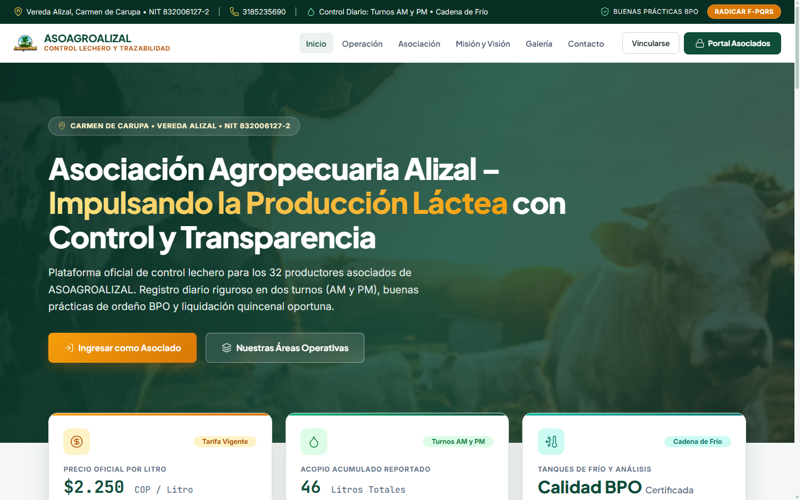
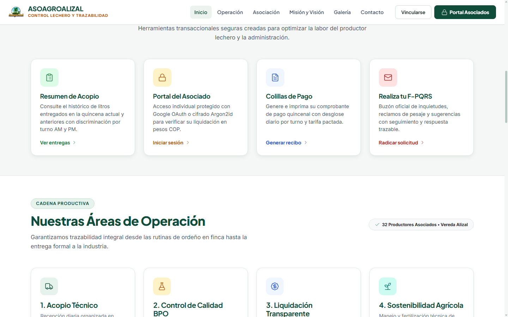
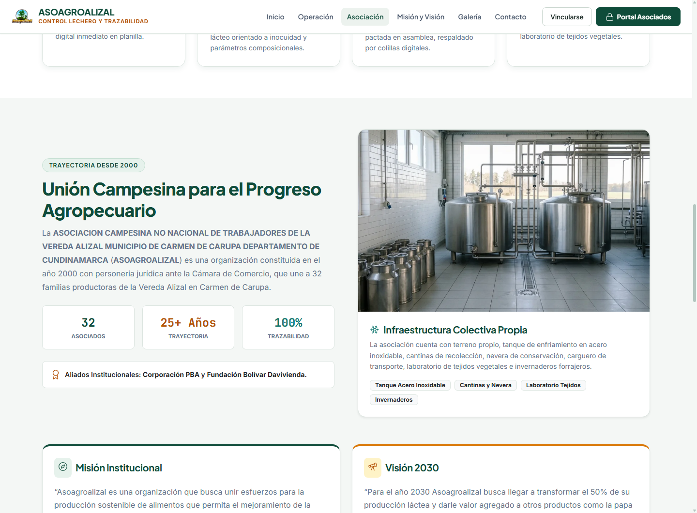
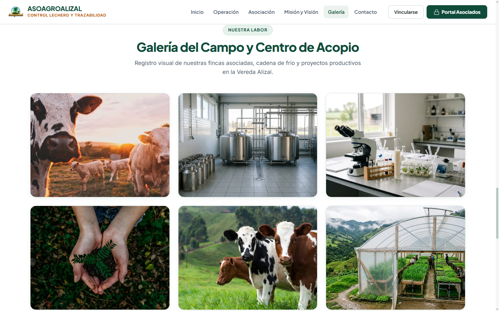
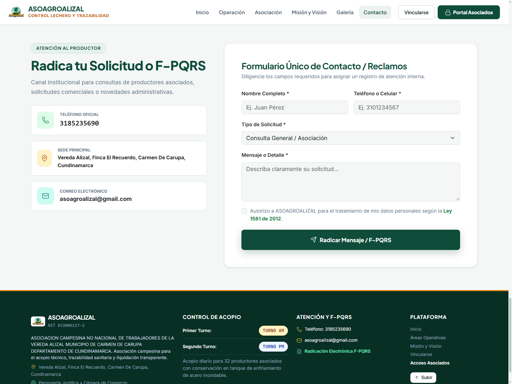
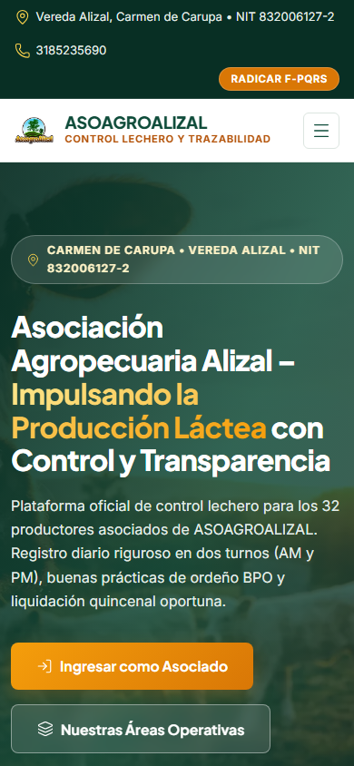
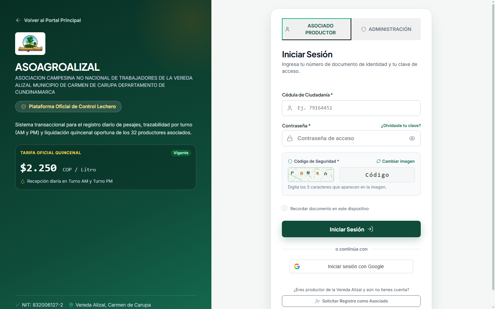
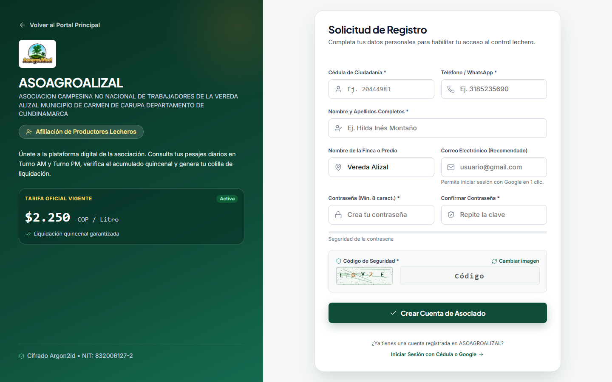
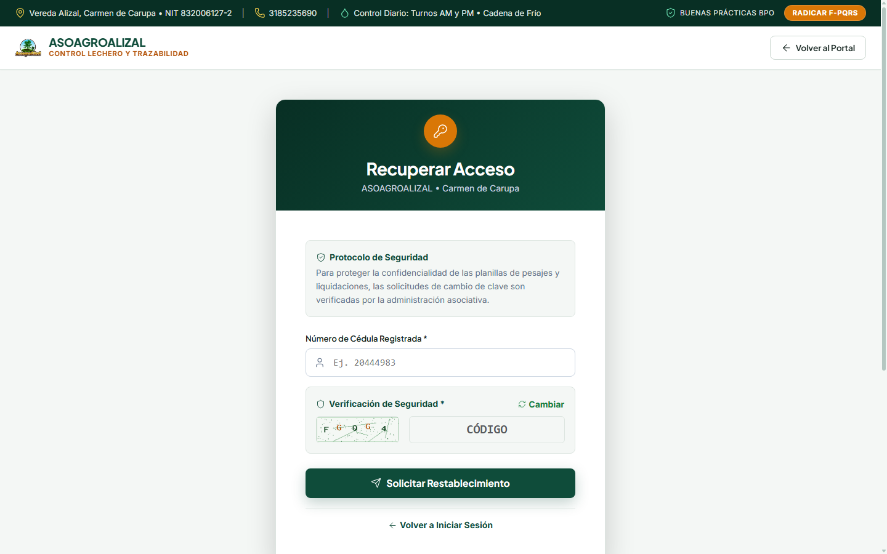
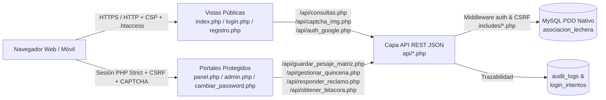

# ASOAGROALIZAL — Plataforma de Control Lechero y Gestión Ganadera


Sistema web integral desarrollado para la **Asociación Campesina No Nacional de Trabajadores de la Vereda Alizal Municipio de Carmen de Carupa Departamento de Cundinamarca (`ASOAGROALIZAL`)**, orientado al registro diario de acopio lechero por turnos (**AM / PM**), liquidación quincenal transparente en pesos colombianos (COP), generación de colillas de pago, gestión de asociados, trazabilidad en bitácora y atención de **F-PQRS**.

---

## Perfil Institucional

| Dato Oficial | Detalle |
| :--- | :--- |
| **Razón Social** | Asociación Campesina No Nacional de Trabajadores de la Vereda Alizal (`ASOAGROALIZAL`) |
| **NIT** | `832006127-2` |
| **Ubicación** | Vereda Alizal, Finca El Recuerdo — Carmen de Carupa, Cundinamarca, Colombia |
| **Asociados Activos** | `32` familias productoras lecheras |
| **Trayectoria** | Constituida en el año `2000` (más de `25` años) |
| **Correo F-PQRS** | `asoagroalizal@gmail.com` |
| **Teléfono Oficial** | `3185235690` |
| **Aliados Institucionales** | Corporación PBA y Fundación Bolívar Davivienda |
| **Política de Bioseguridad** | Control en centro de acopio por turnos **AM / PM** (sin publicación de ventanas horarias físicas externas) |

---

## Sistema Visual y Paleta Refinada

El portal fue rediseñado con una estética agroindustrial limpia, sobria, de alto contraste en **Modo Claro obligatorio (`data-bs-theme="light"`)**, sin emojis en la interfaz de usuario y con iconografía vectorial monocromática **Lucide Icons** (`stroke-width: 1.5px`).

### Paleta *"Bosque Esmeralda, Salvia & Cobre Dorado"*

| Token CSS (`styles.css` / `theme.css`) | Color | Uso Principal en la Plataforma |
| :--- | :---: | :--- |
| `--brand-primary` | `#0F4C3A` | Cabeceras corporativas, barra superior, botones primarios y panel lateral Auth |
| `--brand-primary-dark` | `#082F24` | Estados hover/focus de marca, pie de página y gradientes oscuros |
| `--brand-secondary` | `#15803D` | Énfasis operativos, indicadores de acopio activo y badges de verificación |
| `--brand-accent` | `#D97706` | Botones CTA principales, acento de tarifa quincenal y distinción **Turno AM** |
| `--accent-dusk` | `#1D4ED8` | Identificación visual contrastada para el **Turno PM** en matrices y colillas |
| `--accent-teal` | `#0F766E` | Tarjetas informativas, análisis BPO y etiquetas institucionales |
| `--bg-canvas` | `#F4F7F5` | Fondo alabastro-salvia suave para reducir fatiga visual bajo luz de campo |
| `--bg-surface` | `#FFFFFF` | Superficie de tarjetas, formularios y tabla matricial de planilla |
| `--text-main` / `--text-muted` | `#0F172A` / `#475569` | Tipografía de alta legibilidad verificada bajo estándar WCAG AA/AAA (`tools/verificar_contraste.php`: `11/11 PASS`) |

### Tipografía y Librerías Frontend
- **Títulos:** `Plus Jakarta Sans` (pesos `600`, `700`, `800`).
- **Cuerpo y formularios:** `Inter` (tamaño base `16px`).
- **Cifras técnicas, litros y moneda COP:** `JetBrains Mono` / tabular-nums.
- **Componentes:** Bootstrap `5.3`, Tailwind CSS (preflight desactivado y compatibilidad `.corp-navbar .navbar-collapse`), Lucide Icons, SweetAlert2, DataTables `1.13.8`, ApexCharts y SheetJS (`xlsx@0.18.5`).

---

## Capturas del Programa

> Las siguientes capturas fueron generadas directamente sobre la aplicación corriendo en Apache/PHP (`http://localhost/asociacion/`) tras el rediseño visual y la sincronización de contenido institucional.

### 1. Portal Público — Hero Institucional y Tarjetas de Resumen en Tiempo Real
Muestra la tarifa vigente por litro (`$2.250 COP / Litro`), el acumulado total consultado directamente desde MySQL (`entrega`), acceso rápido a turnos **AM / PM** y llamados a la acción.



### 2. Accesos Transaccionales y Áreas Operativas
Cuatro módulos directos para productores y administración (*Resumen de Acopio*, *Portal del Asociado*, *Colillas de Pago* y *Radicación F-PQRS*) junto a las áreas de la cadena productiva.



### 3. Trayectoria, Infraestructura Colectiva, Misión y Visión 2030
Presenta la razón legal de `ASOAGROALIZAL`, sus `32` asociados, aliados institucionales, fotografía documental del tanque de enfriamiento en acero inoxidable y los bloques oficiales de **Misión Institucional** y **Visión 2030**.



### 4. Galería Documental del Campo y Centro de Acopio
Registro fotográfico optimizado en `.webp` de fincas de la Vereda Alizal, tanques de enfriamiento, laboratorio de tejidos vegetales, sanidad del hato e invernaderos forrajeros.



### 5. Radicación de F-PQRS (Ley 1581 de 2012) y Footer Corporativo
Formulario conectado a `api/consultas.php` con datos de contacto oficiales (`3185235690`, `asoagroalizal@gmail.com`) y pie de página con distintivos **TURNO AM** / **TURNO PM**.



### 6. Diseño Responsivo Móvil (`390px`)
Adaptación completa de navegación colapsable, jerarquía tipográfica y botones táctiles para productores que consultan desde el celular en finca.



### 7. Inicio de Sesión Dual (`login.php`), CAPTCHA GD y Google OAuth 2.0
Pantalla dividida con selector de perfil (**Asociado Productor** / **Administración**), tarifa oficial visible, **CAPTCHA de imagen GD generado en servidor (`api/captcha_img.php`)** e inicio de sesión federado mediante **Google Identity Services (`api/auth_google.php`)**.



### 8. Registro de Nuevos Productores Asociados (`registro.php`)
Formulario validado con cédula, finca, correo opcional para enlace Google OAuth, indicador de fortaleza de contraseña (`Argon2id`) y validación CAPTCHA servidor.



### 9. Recuperación Segura de Acceso (`olvide_password.php`)
Flujo de solicitud de restablecimiento verificado por administración y protegido con CAPTCHA para evitar enumeración o accesos no autorizados.



> **Nota sobre vistas autenticadas (`panel.php` y `admin.php`):** Ambas consolas requieren sesión PHP verificada en servidor, **CAPTCHA GD activo** en el login y validación en caliente contra MySQL (`requireAdminAuth()` / `SessionVersion`), por lo que sus rutas quedan protegidas ante accesos anónimos.

---

## Arquitectura del Sistema



### Estructura de Directorios

```text
pagina-web/
├── index.php                       # Portal institucional público y radicación F-PQRS
├── login.php                       # Inicio de sesión (Cédula/Clave, CAPTCHA y Google OAuth 2.0)
├── registro.php                    # Autoregistro de productores asociados
├── olvide_password.php             # Solicitud de recuperación de contraseña
├── restablecer_password.php        # Cambio de clave mediante token temporal
├── cambiar_password.php            # Cambio obligatorio de clave inicial o voluntario
├── panel.php                       # Portal del Ganadero Asociado (solo lectura + colilla + reclamo)
├── admin.php                       # Consola Administrativa (planilla tipo Excel + CRUD + bitácora)
├── logout.php                      # Cierre seguro de sesión e invalidación de cookie
├── database.sql                    # Esquema completo MySQL, índices y usuarios semilla
├── migration.sql                   # Scripts de actualización estructural
├── .htaccess                       # Bloqueo 403 a .env, .git, includes/, *.sql, *.md y cabeceras HTTP
├── .env.example                    # Plantilla de variables de entorno
├── INICIAR_SISTEMA.bat             # Arranque rápido Apache + MySQL en Windows/XAMPP
├── COMPARTIR_POR_INTERNET.bat      # Exposición temporal por túnel para pruebas remotas
├── includes/
│   ├── config.php                  # Env loader, sesiones Strict, CSP y constantes globales
│   ├── db.php                      # Singleton PDO (EmulatePrepares OFF, UTF8MB4)
│   ├── auth.php                    # Guards de autenticación, roles y sessionVersion
│   ├── csrf.php                    # Generación y verificación de tokens CSRF por formulario/fetch
│   ├── captcha_gd.php              # Generador gráfico de CAPTCHA anti-bots en PHP GD
│   ├── helpers.php                 # Formateadores de moneda, fechas y sanitización
│   ├── header.php                  # Barra institucional + navegación responsiva compartida
│   └── footer.php                  # Pie de página institucional y carga de scripts globales
├── api/
│   ├── db.php                      # Conector API / helpers de respuesta JSON
│   ├── auth_middleware.php         # Middleware `requireAdminAuth()` y verificación de sesión activa
│   ├── captcha_img.php             # Endpoint público de imagen PNG del CAPTCHA
│   ├── captcha.php                 # Utilidades de refresco/validación CAPTCHA
│   ├── login.php                   # Autenticación por cédula + rate limiting (`login_intentos`)
│   ├── auth_google.php             # Validación servidor de Google `id_token` y vínculo por email/google_id
│   ├── registro.php                # Alta de productor con hash Argon2id y validación CAPTCHA
│   ├── recuperar_password.php      # Emisión/solicitud de recuperación de acceso
│   ├── restablecer_con_token.php   # Aplicación de nueva clave con token único
│   ├── cambiar_password.php        # Actualización de contraseña autenticada
│   ├── admin_generar_clave_temporal.php # Emisión administrativa de clave temporal
│   ├── entregas.php                # Consulta de entregas quincenales por productor y turno
│   ├── guardar_pesaje_matriz.php   # Guardado en bloque / celda desde matriz Excel en admin.php
│   ├── gestionar_quincena.php      # Apertura, edición de tarifa, cierre y reapertura de quincenas
│   ├── quincenas.php               # Listado e historial de quincenas
│   ├── ganaderos.php               # CRUD y listado de productores asociados
│   ├── consultas.php               # Radicación y listado de F-PQRS / contacto público
│   ├── enviar_queja.php            # Radicación de reclamo por quincena desde panel del asociado
│   ├── responder_reclamo.php       # Respuesta oficial administrativa con seguimiento
│   └── obtener_bitacora.php        # Lectura de `audit_logs` para auditoría interna
├── assets/
│   ├── css/styles.css              # Sistema de diseño "Bosque Esmeralda, Salvia & Cobre Dorado"
│   ├── css/theme.css               # Estilos de matriz lechera, tablas y utilidades visuales
│   ├── js/app.js                   # Interactividad pública, animaciones y formulario F-PQRS
│   ├── js/theme.js                 # Helpers UI, recarga de CAPTCHA, visor de claves y SweetAlert2
│   └── img/                        # Imágenes optimizadas `.webp` y `.svg`
├── tools/
│   └── verificar_contraste.php     # Auditoría automatizada de contraste WCAG AA/AAA por tokens CSS
└── docs/
    ├── screenshots/                # Capturas oficiales en PNG usadas en este README
    ├── FICHA_OFICIAL_ASOAGROALIZAL.md
    ├── AUDITORIA.md
    └── PRUEBAS_UI.md
```

---

## Cómo Funciona Cada Módulo

### 1. Portal Público y Buzón F-PQRS (`index.php`)
- Consulta dinámicamente en base de datos la quincena activa para mostrar el **Precio Oficial por Litro** vigente y el **Acopio Acumulado Reportado** en litros.
- Integra el formulario único de contacto / reclamos F-PQRS conectado vía `fetch` a `api/consultas.php` con verificación de tratamiento de datos (**Ley 1581 de 2012**).

### 2. Autenticación, Roles y Google Sign-In (`login.php`, `registro.php`)
- **Acceso dual:** selector visual para **Asociado Productor (`GANADERO`)** o **Administración (`ADMIN`)**.
- **Protección contra fuerza bruta:** bloqueo progresivo registrado en `login_intentos` + verificación obligatoria de **CAPTCHA GD (`api/captcha_img.php`)**.
- **Google OAuth 2.0:** `api/auth_google.php` verifica el `id_token` emitido por Google Identity Services y lo enlaza al usuario registrado por correo electrónico (`email` y `google_id`).
- **Primer ingreso del Administrador:** fuerza redirección a `cambiar_password.php` cuando `debeCambiarPassword = 1`.

### 3. Portal del Asociado (`panel.php`)
- Vista de **solo lectura** para cada productor: historial de entregas diarias separadas en **MAÑANA (AM)** y **TARDE (PM)** dentro de la quincena seleccionada.
- Cálculo automático del total de litros y valor bruto a pagar según tarifa de la quincena.
- Generación e impresión de **Colilla Oficial de Pago Quincenal**.
- **Buzón de inconformidades:** aplica límite estricto de **1 reclamo por quincena** por asociado con notificación y seguimiento hacia `asoagroalizal@gmail.com`.

### 4. Consola Administrativa y Matriz Tipo Excel (`admin.php`)
Diseñada para operación rápida de pesajes por toda la quincena:
- **Planilla matricial por turnos (AM / PM):** edición directa en celda con guardado automático / por lote hacia `api/guardar_pesaje_matriz.php`.
- **Navegación tipo hoja de cálculo:** movimiento fluido con `Enter`, `Tab` y teclas de flecha; soporte para **pegado en bloque (`Ctrl+V`) directamente desde Microsoft Excel**.
- **Pie de tabla unificado (`<tfoot>`):** muestra una celda unificada por cada día (`colspan="2"`) con la **suma diaria combinada (`AM + PM`)** recalculada en tiempo real al editar o pegar valores, junto al gran total quincenal.
- **Importación y Exportación:** exportación a CSV y botón de **Importación Inteligente desde Excel (`.xlsx` / `.csv`)** usando `SheetJS`.
- **Gestión de Quincenas y Bloqueo:** creación de períodos, definición de `precioLitro` y cierre/reapertura segura mediante `api/gestionar_quincena.php` para impedir alteraciones retrospectivas.
- **Gestión de Asociados, Respuestas F-PQRS y Bitácora:** buscador en DataTables por cédula o nombre, impresión de colillas individuales, respuesta oficial a reclamos (`api/responder_reclamo.php`) y auditoría cronológica en `api/obtener_bitacora.php`.

---

## Modelo de Base de Datos (`database.sql`)

La plataforma utiliza la base de datos **`asociacion_lechera`** en MySQL/MariaDB (`utf8mb4_unicode_ci`) con las siguientes tablas principales:

| Tabla | Propósito y Campos Clave |
| :--- | :--- |
| **`usuario`** | Almacena administradores y ganaderos (`id`, `cedula`, `nombre`, `email`, `google_id`, `telefono`, `finca`, `passwordHash` Argon2id, `rol`, `activo`, `debeCambiarPassword`, `sessionVersion`) |
| **`quincena`** | Controla períodos quincenales (`id`, `fechaInicio`, `fechaFin`, `precioLitro`, `cerrada`, `cerradaPor`, `cerradaEn`) |
| **`entrega`** | Registro diario de pesajes por usuario, fecha y turno `ENUM('MANANA', 'TARDE')` |
| **`consulta`** | Radicados de contacto público y F-PQRS |
| **`alertaquincena`** | Reclamos e inconformidades por quincena (límite 1 por asociado/quincena) y respuesta oficial |
| **`audit_logs`** | Bitácora inmutable de acciones administrativas (cambios de planilla, cierres, claves) |
| **`login_intentos`** | Registro por IP/cédula para mitigación de ataques de fuerza bruta |

---

## Medidas de Seguridad Implementadas

1. **Hashing robusto:** contraseñas almacenadas con `Argon2id` (con compatibilidad verificada para registros previos).
2. **Prepared Statements nativos:** `PDO::ATTR_EMULATE_PREPARES => false` en toda la capa de datos.
3. **Middleware centralizado (`api/auth_middleware.php`):** verificación en caliente del usuario, estado `activo`, `rol` y `sessionVersion` en base de datos para invalidación instantánea de sesiones.
4. **Protección CSRF y Cookie Hardening:** `session.cookie_httponly = 1`, `SameSite = Strict`, expiración tras `30 minutos` (`1800s`) de inactividad y tokens CSRF por petición.
5. **CSP & Cabeceras HTTP (`includes/config.php` y `.htaccess`):** `X-Frame-Options: SAMEORIGIN`, `X-Content-Type-Options: nosniff`, `Referrer-Policy`, Content Security Policy explícita para fuentes/CDNs autorizados y bloqueo HTTP `403` para `.env`, `.git`, `database.sql`, `includes/`, `logs/` y scripts auxiliares.

---

## Instalación y Puesta en Marcha Local (XAMPP)

### 1. Requisitos
- **XAMPP** (Apache `2.4` + PHP `8.2` con extensión `gd` y `pdo_mysql` habilitadas + MySQL / MariaDB).
- Navegador web moderno (Chrome / Edge / Firefox).

### 2. Clonar y Configurar Entorno
```bash
git clone https://github.com/Nicolas-Moncada/pagina-web.git
cd pagina-web
copy .env.example .env
```
Edite `.env` con sus credenciales de base de datos, secreto JWT, credenciales SMTP y Client ID de Google OAuth (si utiliza inicio de sesión con Google).

### 3. Importar la Base de Datos
Importe el archivo [`database.sql`](database.sql) desde **phpMyAdmin** o mediante línea de comandos:
```powershell
C:\xampp\mysql\bin\mysql.exe -u root < database.sql
```

### 4. Desplegar en XAMPP y Ejecutar
Copie o enlace la carpeta del proyecto en `C:\xampp\htdocs\asociacion\` e inicie los servicios ejecutando [`INICIAR_SISTEMA.bat`](INICIAR_SISTEMA.bat) o desde el Panel de Control de XAMPP.

- **Portal público:** `http://localhost/asociacion/index.php`
- **Acceso / Login:** `http://localhost/asociacion/login.php`

### 5. Verificación Técnica
```powershell
# Validar sintaxis PHP en todo el proyecto
Get-ChildItem -Recurse -Filter *.php | ForEach-Object { C:\xampp\php\php.exe -l $_.FullName }

# Verificar contraste de accesibilidad WCAG AA/AAA de la paleta
C:\xampp\php\php.exe tools/verificar_contraste.php
```
