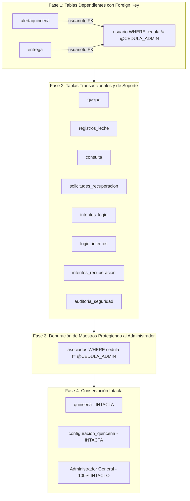

# PLAN DE LIMPIEZA DE BASE DE DATOS PARA PRODUCCIÓN
**Plataforma de Control Lechero - ASOAGROALIZAL**  
**Fecha:** 26 de Octubre de 2026  
**Entorno:** XAMPP (MariaDB 10.4 / MySQL)  
**Base de Datos:** `asociacion_ganaderos`

---

## 1. OBJETIVO Y ALCANCE

El objetivo de este plan es depurar y dejar en estado **cero kilómetros (producción limpia)** la base de datos de la plataforma, eliminando todos los datos transaccionales de prueba, registros temporales, quejas ficticias y cuentas ganaderas de ensayo creadas durante la fase de desarrollo y rediseño.

**Condición Crítica No Negociable:**  
La cuenta del **Administrador General** debe conservarse **100% intacta**:
- Mismo identificador único (`id`)
- Mismo rol de sistema (`ADMIN`)
- Mismo hash criptográfico de contraseña (`passwordHash`)
- Mismos metadatos (`finca`, `telefono`, `activo`, `creadoEn`, `sessionVersion`)
- Sin alteración de un solo bit en la fila.

> [!IMPORTANT]
> **POLÍTICA ESTRICTA DE PRIVACIDAD:**  
> Por directriz de confidencialidad y la Ley 1581 de 2012, el número de identificación del Administrador General **NUNCA** figura en este documento, ni en logs, ni en chats de soporte. Se referencia universalmente bajo el marcador protegido `[CÉDULA-ADMIN-OCULTA]`. Su valor real está configurado de forma estricta y única dentro del script ejecutable `sql/limpieza_total.sql`.

---

## 2. INVENTARIO COMPLETO Y CLASIFICACIÓN DE TABLAS

La base de datos cuenta actualmente con **14 tablas**. A continuación se detalla su estado actual y su clasificación categórica:

| # | Tabla | Registros Actuales | Clasificación | Clave Primaria / Tipo | Relaciones / Dependencias |
|---|---|:---:|:---:|---|---|
| 1 | `alertaquincena` | 0 | **VACIAR** | `id` VARCHAR(191) | FK `usuarioId` $\to$ `usuario(id)` |
| 2 | `entrega` | 7 | **VACIAR** | `id` VARCHAR(191) | FK `usuarioId` $\to$ `usuario(id)` |
| 3 | `quejas` | 0 | **VACIAR** | `id` VARCHAR(191) | Dependencia lógica `asociadoId` |
| 4 | `registros_leche` | 7 | **VACIAR** | `id` VARCHAR(191) | Dependencia lógica `asociadoId` |
| 5 | `consulta` | 1 | **VACIAR** | `id` VARCHAR(191) | Tabla independiente (buzón web) |
| 6 | `solicitudes_recuperacion` | 0 | **VACIAR** | `id` VARCHAR(191) | Tokens y claves temporales de prueba |
| 7 | `intentos_login` | 0 | **VACIAR** | `id` INT(11) AUTO_INC | Contador de rate limiting / bloqueos |
| 8 | `login_intentos` | 0 | **VACIAR** | `id` INT(11) AUTO_INC | Tabla redundante de intentos |
| 9 | `intentos_recuperacion` | 0 | **VACIAR** | `id` INT(11) AUTO_INC | Contador de rate limiting recuperación |
| 10 | `auditoria_seguridad` | 17 | **VACIAR** | `id` INT(11) AUTO_INC | Bitácora de eventos y logs de prueba |
| 11 | `usuario` | 2 | **CONSERVAR ADMIN / VACIAR PRUEBAS** | `id` VARCHAR(191) | Tabla principal de autenticación |
| 12 | `asociados` | 2 | **CONSERVAR ADMIN / VACIAR PRUEBAS** | `id` VARCHAR(191) | Tabla espejo/legada de afiliados |
| 13 | `quincena` | 1 | **CONSERVAR SIN TOCAR** | `id` VARCHAR(191) | Períodos quincenales oficiales |
| 14 | `configuracion_quincena` | 1 | **CONSERVAR SIN TOCAR** | `id` VARCHAR(191) | Tarifas base y precios por litro |

---

## 3. JUSTIFICACIÓN DETALLADA POR TABLA

### A. Categoría: VACIAR (10 tablas)

1. **`alertaquincena`:**  
   Almacena reclamos y notificaciones de inconformidad sobre quincenas. Posee una clave foránea (`usuarioId`) hacia `usuario`. Debe vaciarse completamente antes de purgar los usuarios de prueba para no generar violaciones de integridad referencial.
2. **`entrega`:**  
   Contiene los pesajes diarios de leche (☀️ Mañana / 🌅 Tarde). Los 7 registros actuales son pruebas generadas durante la validación de la planilla matricial. Posee clave foránea hacia `usuario(id)`. Debe vaciarse totalmente para permitir el inicio en ceros de la producción real.
3. **`quejas`:**  
   Tabla paralela/legada del buzón de quejas de asociados. Debe quedar en cero registros.
4. **`registros_leche`:**  
   Tabla espejo/legada de entregas de leche de versiones preliminares. Los 7 registros son datos sintéticos de prueba que deben eliminarse.
5. **`consulta`:**  
   Buzón de recepción de mensajes desde el formulario público de contacto de la landing page. El registro existente corresponde a un envío de prueba durante la auditoría. Debe vaciarse para no mezclar pruebas con mensajes reales de la comunidad.
6. **`solicitudes_recuperacion`:**  
   Contiene tokens y hashes de claves temporales de recuperación de acceso. Al ser datos temporales de prueba, deben eliminarse por higiene de seguridad.
7. **`intentos_login`:**  
   Control de mitigación de ataques de fuerza bruta para inicio de sesión. Debe vaciarse y reiniciar su contador `AUTO_INCREMENT = 1`.
8. **`login_intentos`:**  
   Estructura alterna de control de intentos de acceso. Debe vaciarse y reiniciar su `AUTO_INCREMENT = 1`.
9. **`intentos_recuperacion`:**  
   Control de rate limiting sobre la solicitud de contraseñas olvidadas. Debe vaciarse y reiniciar su `AUTO_INCREMENT = 1`.
10. **`auditoria_seguridad`:**  
    Registro de auditoría forense interna (IPs, eventos de inicio de sesión, cambios de clave). Los 17 registros actuales reflejan la actividad de desarrollo local. Se purga para que la auditoría de producción comience desde el evento 1 real con `AUTO_INCREMENT = 1`.

### B. Categoría: CONSERVAR SIN TOCAR (2 tablas)

1. **`quincena`:**  
   Define la ventana temporal de liquidación activa (fechas de inicio y fin, precio por litro base y estado abierta/cerrada). Conservar esta estructura permite que el administrador ingrese directamente a registrar pesajes sin necesidad de reconfigurar la quincena desde cero.
2. **`configuracion_quincena`:**  
   Mantiene el historial tarifario de respaldo. Se conserva sin alteraciones para salvaguardar la consistencia de parámetros del sistema.

### C. Categoría: CONSERVAR ADMIN / VACIAR PRUEBAS (2 tablas)

1. **`usuario`:**  
   Contiene 2 filas: la cuenta activa del Administrador General (`rol = 'ADMIN'`) y 1 cuenta de ganadero de prueba (`rol = 'GANADERO'`). Se elimina de forma estricta el ganadero de prueba (`WHERE cedula != @CEDULA_ADMIN`) y se protege con barrera condicional la fila del Administrador General.
2. **`asociados`:**  
   Tabla complementaria que replica el catálogo de asociados. Se elimina la fila del ganadero sintético y se preserva intacto el Administrador General.

### D. Categoría: DUDOSAS

**Total de tablas dudosas:** **0 (Ninguna)**.  
*Motivo técnico:* Cada una de las 14 tablas del esquema de datos de `asociacion_ganaderos` ha sido identificada, leída y correlacionada tanto en el código fuente PHP como en el historial de migraciones. No existe ninguna entidad huérfana o de origen desconocido.

---

## 4. MATRIZ DE DEPENDENCIAS Y ORDEN DE ELIMINACIÓN

Para garantizar el cumplimiento de restricciones de integridad referencial de MySQL/MariaDB sin deshabilitar artificialmente las claves foráneas (`FOREIGN_KEY_CHECKS = 1`), el vaciado se ejecuta en el siguiente orden estricto:



---

## 5. MECANISMO DE VERIFICACIÓN CRIPTOGRÁFICA (CHECKSUM SHA-256)

Para verificar con certeza matemática absoluta que el registro del Administrador General no sufrió alteración alguna (ni en su ID, ni en su hash de clave, ni en fechas, ni en estados), el script ejecuta una verificación criptográfica de integridad:

$$\text{Hash}_{\text{Admin}} = \text{SHA256}(\text{id} \parallel \text{cedula} \parallel \text{nombre} \parallel \text{telefono} \parallel \text{finca} \parallel \text{passwordHash} \parallel \text{rol} \parallel \text{activo} \parallel \text{creadoEn} \parallel \text{debeCambiarPassword} \parallel \text{sessionVersion} \parallel \text{email})$$

1. Se computa $\text{Hash}_{\text{Antes}}$ antes de iniciar los borrados.
2. Se ejecutan las operaciones dentro de una transacción `START TRANSACTION`.
3. Se computa $\text{Hash}_{\text{Después}}$ tras completar los borrados.
4. Se valida:
   $$\text{Hash}_{\text{Antes}} \equiv \text{Hash}_{\text{Después}}$$
   Si la comparación es idéntica, la integridad está 100% garantizada. Si existiera la más mínima divergencia, el script aborta y emite alerta.

---

## 6. PROTOCOLO DE RESPALDO Y PROCEDIMIENTO DE ROLLBACK

### A. Respaldo previo (Obligatorio antes de ejecutar en phpMyAdmin)

Ejecutar en la consola de comandos de Windows (PowerShell) el respaldo completo de la base de datos:

```powershell
& "C:\xampp\mysql\bin\mysqldump.exe" -u root asociacion_ganaderos > "c:\visual estudio code\pagina web\sql\backup_pre_limpieza_total.sql"
```

O desde phpMyAdmin:
1. Ir a `http://localhost/phpmyadmin/`.
2. Seleccionar la base de datos `asociacion_ganaderos` en el panel izquierdo.
3. Hacer clic en la pestaña **Exportar**.
4. Seleccionar método **Rápido**, formato **SQL** y hacer clic en **Exportar**.

### B. Procedimiento de Rollback en caso de contingencia

Si durante la ejecución se deseara revertir el estado exacto de la base de datos:

1. **Desde la misma sesión SQL:** Si la transacción aún no ha sido confirmada con `COMMIT`, simplemente ejecutar:
   ```sql
   ROLLBACK;
   ```
2. **Desde el archivo de respaldo:**
   ```powershell
   & "C:\xampp\mysql\bin\mysql.exe" -u root asociacion_ganaderos < "c:\visual estudio code\pagina web\sql\backup_pre_limpieza_total.sql"
   ```
   O en phpMyAdmin $\to$ pestaña **Importar** $\to$ Seleccionar `backup_pre_limpieza_total.sql` $\to$ **Continuar**.
